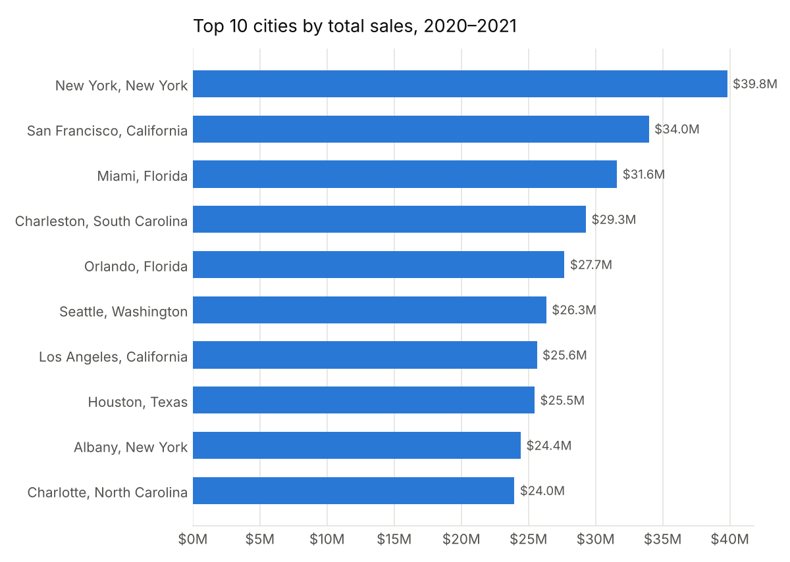
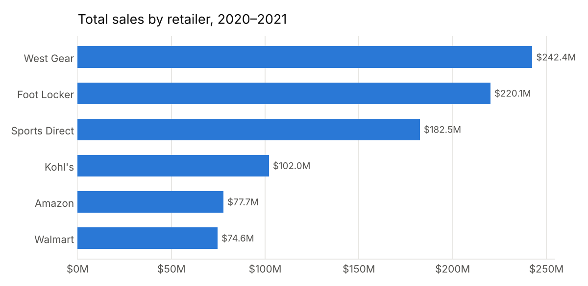
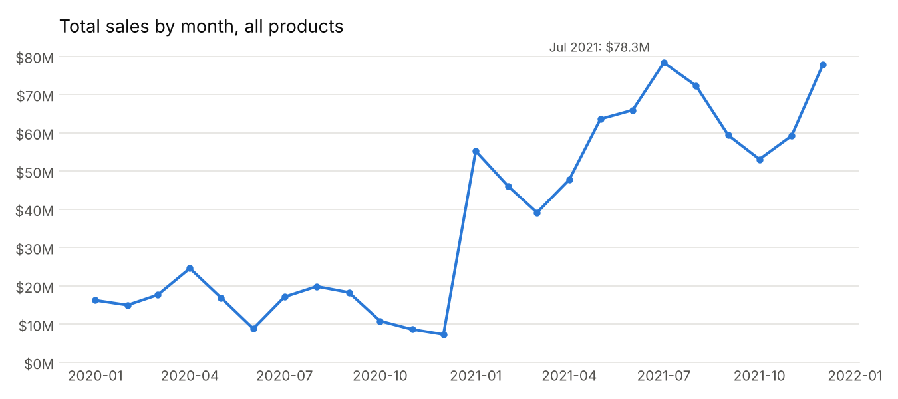

# Athletic Sales Analysis

A repeatable sales report showing which cities, retailers, and months sell the most.

The report combines two years of U.S. athletic footwear and apparel sales (2020 and 2021, 9,643 transactions) and answers three questions: where sales are strongest, which retailers drive them, and when they peak. Every number below comes from running [`notebooks/athletic_sales_analysis.ipynb`](notebooks/athletic_sales_analysis.ipynb).

## Findings

### Top cities

| Rank | City | Total sales | Units sold |
|---|---|---|---|
| 1 | New York, NY | $39,801,235 | 111,954 |
| 2 | San Francisco, CA | $33,973,228 | 85,478 |
| 3 | Miami, FL | $31,600,863 | 73,135 |

By units sold, Houston, TX ranks second (90,322 units) but drops out of the top 3 by dollars: it sells volume at lower prices.



### Top retailers

| Rank | Retailer | Total sales |
|---|---|---|
| 1 | West Gear | $242,398,341 |
| 2 | Foot Locker | $220,094,720 |
| 3 | Sports Direct | $182,470,997 |

The single strongest retailer-city pair is **West Gear in San Francisco** ($32,794,405). West Gear in San Francisco also sold the most women's athletic footwear (12,107 units), ahead of Foot Locker in New York (10,996) and Kohl's in Los Angeles (10,826).



### Peak periods

| Rank | Month | Total sales (all products) |
|---|---|---|
| 1 | July 2021 | $78,334,681 |
| 2 | December 2021 | $77,815,430 |
| 3 | August 2021 | $72,288,221 |

Two windows stand out: **mid-summer** and **the December holidays**. Women's athletic footwear follows the same pattern. Its best single day was July 16, 2021 ($1,521,825) and its best week ended December 19, 2021 ($3,098,970).



## What this means for a client

The value here is not one set of answers. The value is that the questions are built once and can be re-run on new data.

1. **Write the report once, as a system.** The notebook is a fixed pipeline: load the sales files, clean them, and produce the same tables and charts every time. Drop next month's CSV into `data/`, re-run, and the numbers update with no rework.
2. **Let AI summarize it each month.** The notebook's output tables are small and structured, so an AI assistant can read them and write the plain-language update: which cities moved, which retailer gained, whether the summer and December peaks held. This is the "Second Brain" idea. The system does the counting, the AI writes the summary, and a person reviews it and decides.

The AI summary step is a proposed next step. It is not built in this repo.

## Limitations

- **The two years are not comparable in size.** 2020 has 1,297 rows and 2021 has 8,346. The jump in the monthly chart likely reflects how much data was recorded, not real growth. That is also why every top period falls in 2021.
- **Sales, not profit.** Rankings use `total_sales` (revenue). The data has an `operating_profit` column that this report does not analyze.
- **`retailer_id` is not reliable.** The same ID appears under several retailer names, so the report groups by retailer name instead.
- **Bootcamp dataset.** The data came with a Columbia data analytics bootcamp assignment. Treat it as practice data, not a real company's books.

## Run it yourself

```bash
pip install -r requirements.txt
cd notebooks
jupyter notebook athletic_sales_analysis.ipynb   # then Run All
```

Running the notebook top to bottom regenerates the charts in `images/`.

## Project structure

```
data/        2020 and 2021 sales CSVs
notebooks/   athletic_sales_analysis.ipynb (analysis + chart generation)
images/      charts used in this README
```

Built with pandas and matplotlib by La Raven Gordon.
